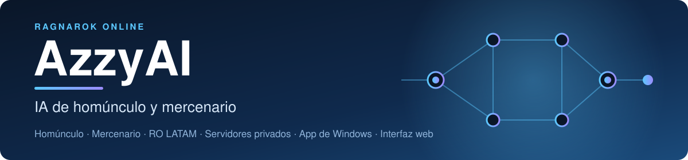

  

  <a href="README.md">English</a> · <a href="README.pt-BR.md">Português (BR)</a> · <a href="README.es.md">Español</a>

Una IA más inteligente para tu **homúnculo o mercenario** en Ragnarok Online.
Elige a quién atacar y qué habilidad usar, y tú cambias su comportamiento en una
ventana o en el navegador, sin código que editar.

**En el juego, eso significa:**

- Conoce a cada monstruo: Dieter no lanza Lava Slide contra un monstruo de Fuego
  y no se gasta SP en plantas.
- No despierta a un MVP sin querer, pero igual te defiende si uno ataca.
- Un monstruo al que le ordenas atacar se combate hasta que muera, aunque te alejes.
- Las habilidades de área apuntan al grupo más grande de monstruos que realmente
  recibiría daño.
- Una habilidad que se interrumpe una y otra vez se pausa unos segundos, y usa
  otra cosa.
- Habilidades de Eira, Bayeri, Sera, Dieter y Eleanor, con los valores que usa tu servidor.

[Mira todo lo que añade esta versión y cómo se compara con el AzzyAI original](docs/ABOUT.es.md).

Esta es una continuación comunitaria del [AzzyAI original](https://github.com/SpenceKonde/AzzyAI),
no un producto oficial de Gravity. Se prueba sin conexión y en un servidor rAthena
local, no en todo cliente o servidor oficial, así que prueba primero con un
monstruo fácil. Respeta las reglas de tu servidor sobre IA personalizada.

## Instalar

1. **Respalda la carpeta `AI` del juego** (cópiala a un lugar seguro). Volver
   atrás es ponerla de nuevo.
2. [Descarga el ZIP](https://github.com/jknpj/AzzyAI/releases/latest)
   y descomprímelo.
3. Abre la carpeta descomprimida y luego su carpeta `USER_AI`. Copia **todo lo que
   hay dentro** de `USER_AI` en la carpeta `AI\USER_AI` de tu juego. No crees una
   carpeta `USER_AI` dentro de otra `USER_AI`.
4. En el juego, escribe **`/hoai`** hasta que el mensaje diga que la IA
   personalizada del homúnculo está activa (para un mercenario, **`/merai`**).
5. Invoca de nuevo al homúnculo, o reconéctate, para que el juego cargue los archivos nuevos.

**¿Ya usas AzzyAI?** Copiar archivos encima de los tuyos reemplaza tus ajustes,
tácticas y lista de amigos. Lee antes el
[checklist de actualización](docs/MANUAL.es.md#actualizaciones-y-respaldos).

## Configurar

Abre la [configuración en el navegador](https://jknpj.github.io/AzzyAI-webgui/),
elige **AzzyAI** (no el Classic), luego **File > Open USER_AI folder** y selecciona la carpeta
`AI\USER_AI` de tu juego. Cambia lo que quieras y haz clic en **Apply**. (¿Prefieres
una aplicación Windows? Ejecuta [AzzyAIConfig.exe](USER_AI/AzzyAIConfig.exe) desde
esa misma carpeta.) La descarga también incluye una copia sin conexión en
`webgui/` (abre `webgui/index.html`). Después, recarga la IA en el juego.

**Empieza por estos:**

- En `ServerType`, elige **Official** (oficial) o **Private** (privado).
- Activa solo las habilidades que quieras, en los niveles que el homúnculo ya aprendió.
- Cambia una cosa por vez y recarga la IA entre pruebas.

El juego lee los ajustes instalados en su propia carpeta, no una copia en la
carpeta de descargas. La página está en English, Português y Español; los
nombres de las opciones siguen en inglés.

## Ayuda

- **¿No sabes qué cambiar?** [Pídele a un chat de IA que lea tus ajustes y te explique](docs/AI-HELP.es.md): una solicitud lista para pegar.
- **Guía completa:** [manual del usuario](docs/MANUAL.es.md) (instalación, cada ajuste, cada homúnculo, problemas frecuentes). También en [English](docs/MANUAL.md) y [Português (BR)](docs/MANUAL.pt-BR.md).
- **¿Encontraste un error?** Usa el [formulario de reporte de errores](https://github.com/jknpj/AzzyAI/issues/new/choose) e indica homúnculo, servidor, habilidades activadas, lo que ocurrió y la línea `Release:` de `AAIStartH.txt`. **Nunca compartas contraseñas, credenciales ni archivos privados.**
- **¿Problema de seguridad?** No lo publiques: consulta la [política de seguridad](SECURITY.md) (en inglés).
- **¿Quieres ayudar?** [Cómo contribuir](CONTRIBUTING.md) (en inglés).
- **Desarrolladores:** [referencia técnica](docs/TECHNICAL.md) (en inglés).

Descarga solo de este repositorio y de la página web indicada arriba: un
repositorio con nombre parecido o un README copiado no hace oficial una descarga.

## Créditos

Basado en AzzyAI de Dr. Azzy / [SpenceKonde](https://github.com/SpenceKonde/AzzyAI),
con contribuciones de [samufacanha2](https://github.com/samufacanha2/AzzyAI),
[Kisaro](https://github.com/Kisaro/AzzyAI) y
[vorpal1337](https://github.com/vorpal1337). Sitio original: [drazzy.com](http://drazzy.com/ro/ai).

## Licencia

El AzzyAI original no tiene licencia de su autor, así que el código que esta versión heredó
de él tampoco la tiene. Lo que es nuevo aquí (el arnés de pruebas, las
herramientas, los manuales, los datos de monstruos y los presets por tipo) está
bajo la **GNU General Public License v3.0**. [NOTICE.md](NOTICE.md) (en inglés)
indica exactamente qué archivos son cuáles, y [LICENSES/GPL-3.0.txt](LICENSES/GPL-3.0.txt)
tiene el texto de la licencia. La herramienta de configuración en el navegador
tiene su propia licencia GPL-3.0. Ragnarok Online pertenece a Gravity Co., Ltd.;
este proyecto no está afiliado a ella.
