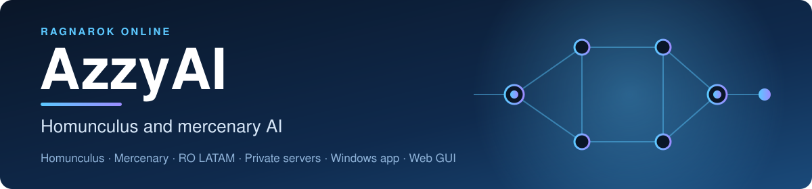

  

  <a href="README.md">English</a> · <a href="README.pt-BR.md">Português (BR)</a> · <a href="README.es.md">Español</a>

A smarter brain for your **homunculus or mercenary** in Ragnarok Online. It picks
who to attack and which skill to use, and you change how it behaves in a window
or in your browser, with no code to edit.

**In game, that means:**

- It knows every monster, so Dieter does not throw Lava Slide at a Fire monster
  and no SP is wasted on plants.
- It does not wake up an MVP by accident, but still defends you if one attacks.
- A monster you order it to attack is fought until it dies, even if you walk away.
- Area skills are aimed at the biggest group of monsters that would really be hurt.
- A skill that keeps getting interrupted is paused for a few seconds, and it
  uses something else.
- Skills for Eira, Bayeri, Sera, Dieter and Eleanor, with the values your server uses.

[See everything this version adds, and how it compares with the original AzzyAI](docs/ABOUT.md).

This is a community continuation of [the original AzzyAI](https://github.com/SpenceKonde/AzzyAI),
not an official Gravity product. It is tested offline and on a local rAthena
server, not on every official client or server, so test on an easy monster first.
Follow your server's rules for custom AI.

## Install

1. **Back up your game's `AI` folder** (copy it somewhere safe). Going back is
   just putting it back.
2. [Download the ZIP](https://github.com/jknpj/AzzyAI/archive/refs/heads/LATAM-HG.zip)
   and unzip it.
3. Open the unzipped folder, then its `USER_AI` folder. Copy **everything inside**
   `USER_AI` into your game's `AI\USER_AI` folder. Do not create a `USER_AI`
   folder inside another `USER_AI`.
4. In the game, type **`/hoai`** until the message says custom homunculus AI is on
   (for a mercenary, **`/merai`**).
5. Summon the homunculus again, or reconnect, so the game loads the new files.

**Already using AzzyAI?** Copying files over yours replaces your settings, tactics
and friend list. Read the [update checklist](docs/MANUAL.md#updates-and-backups) first.

## Set it up

Open the [web configuration](https://jknpj.github.io/AzzyAI-webgui/) in your
browser, choose **AzzyAI** (not Classic), then **File > Open USER_AI folder** and pick your
game's `AI\USER_AI` folder. Change what you want and click **Apply**. (Prefer a
Windows app? Run [AzzyAIConfig.exe](USER_AI/AzzyAIConfig.exe) from that same folder.)
Then reload the AI in the game.

**Start with these:**

- Under `ServerType`, choose **Official** or **Private**.
- Turn on only the skills you want, at levels your homunculus has learned.
- Change one thing at a time, and reload the AI between tests.

The game reads the settings installed in its own folder, not a copy in your
downloads. The page is in English, Português and Español; the option names stay
in English.

## Get help

- **Not sure what to change?** [Ask an AI chat to read your settings and explain](docs/AI-HELP.md): a ready-made request you paste in.
- **Full guide:** [user manual](docs/MANUAL.md) (install, every setting, each homunculus, troubleshooting). Also in [Português (BR)](docs/MANUAL.pt-BR.md) and [Español](docs/MANUAL.es.md).
- **Found a bug?** Use the [bug report form](https://github.com/jknpj/AzzyAI/issues/new/choose) and say the homunculus, server, enabled skills, what happened and the `Release:` line of `AAIStartH.txt`. **Never share passwords, account credentials or private files.**
- **Security problem?** Do not post it publicly: see the [security policy](SECURITY.md).
- **Want to help?** [How to contribute](CONTRIBUTING.md).
- **Developers:** [release notes and technical reference](docs/RELEASE_NOTES.md).

Download only from this repository, and the web page linked above: a similar
repository name or a copied README does not make a download official.

## Credits

Based on AzzyAI by Dr. Azzy / [SpenceKonde](https://github.com/SpenceKonde/AzzyAI),
with contributions from [samufacanha2](https://github.com/samufacanha2/AzzyAI),
[Kisaro](https://github.com/Kisaro/AzzyAI) and
[vorpal1337](https://github.com/vorpal1337). Original site: [drazzy.com](http://drazzy.com/ro/ai).

## License

The original AzzyAI has no license from its author, so the code this version
inherited from it has none either. What is new here (the test harness, tools, manuals,
the monster data and the type presets) is under the **GNU General Public License
v3.0**. [NOTICE.md](NOTICE.md) lists exactly which files are which, and
[LICENSES/GPL-3.0.txt](LICENSES/GPL-3.0.txt) has the license text. The browser
configuration tool has its own GPL-3.0 license. Ragnarok Online belongs to
Gravity Co., Ltd.; this project is not affiliated with it.
