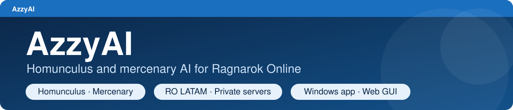

# AzzyAI para Ragnarok Online

[English](README.md) | [Português (BR)](README.pt-BR.md) | [Español](README.es.md)

* * *

Um cérebro mais esperto para o seu **homúnculo ou mercenário** em Ragnarok
Online. Ele escolhe quem atacar e qual habilidade usar, e você muda o
comportamento dele numa janela ou no navegador, sem código para editar.

**No jogo, isso significa:**

- Ele conhece cada monstro: o Dieter não joga Lava Slide num monstro de Fogo e
  não se gasta SP em plantas.
- Ele não acorda um MVP sem querer, mas ainda defende você se um atacar.
- Habilidades em área são apontadas para o maior grupo de monstros que realmente
  sofreria dano.
- Uma habilidade que vive sendo interrompida é pausada por alguns segundos, e ele
  usa outra coisa.
- Habilidades de Eira, Bayeri, Sera, Dieter e Eleanor, com os valores que o seu servidor usa.

[Veja tudo o que esta versão acrescenta e como ela se compara ao AzzyAI original](docs/ABOUT.pt-BR.md).

Esta é uma continuação comunitária do [AzzyAI original](https://github.com/SpenceKonde/AzzyAI),
não um produto oficial da Gravity. Ela é testada offline e num servidor rAthena
local, não em todo cliente ou servidor oficial, então teste primeiro num monstro
fácil. Respeite as regras do seu servidor sobre IA personalizada.

## Instalar

1. **Faça backup da pasta `AI` do jogo** (copie-a para um lugar seguro). Voltar é
   só colocá-la de volta.
2. [Baixe o ZIP](https://github.com/jknpj/AzzyAI/archive/refs/heads/LATAM-HG.zip)
   e descompacte.
3. Abra a pasta descompactada e depois a pasta `USER_AI` dela. Copie **tudo o que
   está dentro** de `USER_AI` para a pasta `AI\USER_AI` do seu jogo. Não crie uma
   pasta `USER_AI` dentro de outra `USER_AI`.
4. No jogo, digite **`/hoai`** até a mensagem dizer que a IA personalizada do
   homúnculo está ativa (para mercenário, **`/merai`**).
5. Invoque o homúnculo de novo, ou reconecte, para o jogo carregar os arquivos novos.

**Já usa o AzzyAI?** Copiar arquivos por cima dos seus substitui suas
configurações, táticas e lista de amigos. Leia antes o
[checklist de atualização](docs/MANUAL.pt-BR.md#atualizações-e-backups).

## Configurar

Abra a [configuração no navegador](https://jknpj.github.io/AzzyAI-webgui/),
escolha **AzzyAI** (não o Classic), depois **File > Open USER_AI folder** e selecione a pasta
`AI\USER_AI` do seu jogo. Mude o que quiser e clique em **Apply**. (Prefere um
aplicativo Windows? Execute o [AzzyAIConfig.exe](USER_AI/AzzyAIConfig.exe) dessa
mesma pasta.) Depois, recarregue a IA no jogo.

**Comece por estas:**

- Em `ServerType`, escolha **Official** (oficial) ou **Private** (privado).
- Ative só as habilidades que quiser, nos níveis que o homúnculo já aprendeu.
- Mude uma coisa por vez e recarregue a IA entre os testes.

O jogo lê as configurações instaladas na própria pasta, não uma cópia na pasta de
downloads. A página está em English, Português e Español; os nomes das opções
continuam em inglês.

## Ajuda

- **Não sabe o que mudar?** [Peça a um chat de IA que leia as suas configurações e explique](docs/AI-HELP.pt-BR.md): um pedido pronto para colar.
- **Guia completo:** [manual do usuário](docs/MANUAL.pt-BR.md) (instalação, cada configuração, cada homúnculo, problemas comuns). Também em [English](docs/MANUAL.md) e [Español](docs/MANUAL.es.md).
- **Achou um bug?** Use o [formulário de relato de bug](https://github.com/jknpj/AzzyAI/issues/new/choose) e informe homúnculo, servidor, habilidades ativadas, o que aconteceu e a linha `Release:` do `AAIStartH.txt`. **Nunca compartilhe senhas, credenciais ou arquivos privados.**
- **Problema de segurança?** Não o publique: veja a [política de segurança](SECURITY.md) (em inglês).
- **Quer ajudar?** [Como contribuir](CONTRIBUTING.md) (em inglês).
- **Desenvolvedores:** [notas de versão e referência técnica](docs/RELEASE_NOTES.md) (em inglês).

Baixe somente deste repositório e da página web indicada acima: um repositório
com nome parecido ou um README copiado não torna um download oficial.

## Créditos

Baseado no AzzyAI de Dr. Azzy / [SpenceKonde](https://github.com/SpenceKonde/AzzyAI),
com contribuições de [samufacanha2](https://github.com/samufacanha2/AzzyAI),
[Kisaro](https://github.com/Kisaro/AzzyAI) e
[vorpal1337](https://github.com/vorpal1337). Site original: [drazzy.com](http://drazzy.com/ro/ai).

## Licença

O AzzyAI original não tem licença do autor, então o código que esta versão herdou dele
também não tem. O que é novo aqui (a harness de testes, as ferramentas, os
manuais, os dados de monstros e os presets por tipo) está sob a **GNU General
Public License v3.0**. O [NOTICE.md](NOTICE.md) (em inglês) lista exatamente
quais arquivos são quais, e o [LICENSES/GPL-3.0.txt](LICENSES/GPL-3.0.txt) tem o
texto da licença. A ferramenta de configuração no navegador tem a sua própria
licença GPL-3.0. Ragnarok Online pertence à Gravity Co., Ltd.; este projeto não
é afiliado a ela.
