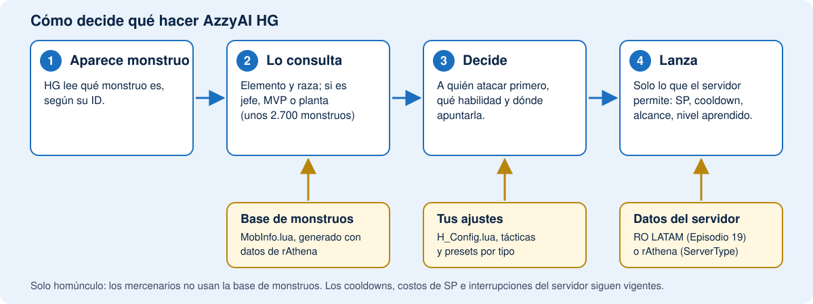

# Qué añade esta versión de AzzyAI

[English](ABOUT.md) | [Português (BR)](ABOUT.pt-BR.md) | [Español](ABOUT.es.md)

[Volver al README](../README.es.md) | [Manual del usuario](MANUAL.es.md)

## Cómo funciona

El homúnculo lee qué monstruo está viendo y lo consulta en una lista de unos
2.700 monstruos. Tus ajustes y tácticas deciden entonces a quién atacar y qué
habilidad usar, y los datos del servidor mantienen cada lanzamiento dentro de lo
que tu servidor acepta. [Abrir la figura en tamaño completo](hg-how-es.svg).

## Qué puedes configurar

| Homúnculo | Habilidades que puede usar | Conviene saber |
|---|---|---|
| **Eira** | Xeno Slasher, Eraser Cutter, Silent Breeze, Twister Cutter, Absolute Zephyr, Overed Boost, Light of Regenerate | Light of Regenerate es opcional y viene desactivada: requiere intimidad Leal y la reduce en cada lanzamiento. |
| **Bayeri** | Stahl Horn, Heilige Stange, Stein Wand, Goldene Ferse, Angriffs Modus, Glanzen Spies, Heilige Pferd, Goldene Tone | El preset de Bayeri elige entre Stahl Horn, Spies y las habilidades de área según la DEF del objetivo. |
| **Sera** | Needle of Paralyze, Poison Mist, Summon Legion, Pain Killer, Toxin of Mandara, Needle Stinger | Toxin of Mandara y Needle Stinger tienen lanzamientos que pueden interrumpirse. |
| **Dieter** | Magma Flow, Granitic Armor, Lava Slide, Pyroclastic, Volcanic Ash, Blast Forge, Tempering | Sus ataques son de área, así que su preset ataca incluso a un solo monstruo. Las habilidades de fuego se omiten contra monstruos de Fuego. |
| **Eleanor** | Style Change, Sonic Claw, Silvervein Rush, Midnight Frenzy, Tinder Breaker, CBC, EQC, Blazing And Furious, The One Fighter Rises | Sonic Claw requiere el estilo lucha; Tinder Breaker, CBC y EQC requieren el estilo agarre. La IA cambia de estilo por ti. |
| **Lif, Amistr, Filir, Vanilmirth** | Sus propias habilidades, y las heredadas en un Homúnculo S | Detecta solo el tipo base de un Homúnculo S. |
| **Mercenarios** | Tácticas, habilidades y kiting, como en el AzzyAI original | No usan la base de datos de monstruos. |

Las habilidades solo funcionan si tu servidor las ofrece y el homúnculo las ha
aprendido. El [manual del usuario](MANUAL.es.md#6-consejos-por-homúnculo-s) tiene notas sobre cada uno.

## Comparación con el AzzyAI original

El AzzyAI original (la rama `classic`) sigue siendo una buena IA. Esta versión conserva lo
que hace y añade lo siguiente. Esto es lo que notarías en el juego:

| | AzzyAI original | Esta versión |
|---|---|---|
| **¿Qué monstruo es?** | Sin datos de monstruos. Tú escribes una fila de táctica para cada uno. | Conoce el elemento, la raza y si es jefe/MVP/planta de cada monstruo (unos 2.700), así que funciona bien con monstruos que nunca configuraste. |
| **Habilidades y elemento** | Usa la habilidad incluso contra un monstruo que la resiste. | Omite la habilidad que haría menos de la mitad del daño (ajustable) y usa otro ataque. Dieter no lanza Lava Slide contra un monstruo de Fuego. |
| **Habilidades de área** | Cuenta monstruos, sea cual sea su elemento. | Cuenta solo los monstruos que realmente recibirían daño y apunta a ellos, incluso cuando el de enfrente es inmune. |
| **Plantas y hongos** | Adivina las plantas por su comportamiento (`AutoDetectPlant`). | Sabe exactamente cuáles son plantas (reciben 1 de daño de todo) y guarda el SP para los demás. |
| **MVP** | Solo lo que pongas en las tácticas. | Por defecto no *empieza* peleas con un MVP, pero igual te defiende. Opcional: atacar siempre a los MVP. |
| **Un lanzamiento que se interrumpe una y otra vez** | Un límite fijo de reintentos (`SkillRetryLimit`), nada más inteligente. | Pausa la habilidad unos segundos tras algunas interrupciones y usa otra cosa. |
| **Niveles de habilidades** | La mayoría de las habilidades de Homúnculo S se detienen en el nivel 5 en su tabla. | Niveles máximos actuales (10 en la mayoría) y solo lanza niveles que el homúnculo ya aprendió. |
| **Habilidades de Homúnculo S** | Lo básico de Eira, Bayeri, Sera, Dieter y Eleanor. | También Twister Cutter, Absolute Zephyr, Toxin of Mandara, Needle Stinger, Glanzen Spies, Heilige Pferd, Goldene Tone, Blazing And Furious, The One Fighter Rises, Blast Forge y Tempering. |
| **Eleanor** | Cambio de estilo y combos. | También esferas según las reglas del servidor (cuánto cuesta cada habilidad), tiempos de los combos y las dos habilidades nuevas. |
| **Los números de tu servidor** | Un único conjunto de valores. | Datos oficiales (RO LATAM, Episodio 19) o de rAthena, elegidos con `ServerType`, para que cooldowns, alcances y costos coincidan con tu servidor. |
| **Configuración** | Aplicación Windows. | La aplicación Windows y una **página en el navegador** en English, Português y Español, con descripciones de habilidades, presets por homúnculo y sugerencia de tácticas de monstruos por mapa. |
| **Actualizaciones** | Manuales. | La aplicación Windows actualiza la IA y los datos de monstruos por ti, sin tocar tus ajustes. |
| **Pruebas** | Sin suite de pruebas sin conexión. | Cada cambio se ejecuta contra un servidor simulado (decenas de escenarios) antes de publicarse. |

Las funciones que reconocen monstruos son para **homúnculos**. Los mercenarios
reciben las herramientas y las correcciones de errores, pero no la base de datos
de monstruos.

## ¿Vale la pena cambiar?

**Te conviene si** juegas con Eira, Bayeri, Sera, Dieter o Eleanor, quieres
ajustar el comportamiento sin leer código, o cazas grupos de monstruos y quieres
que las habilidades de área se usen bien.

**Quizá no lo necesites si** tu IA actual ya hace lo que quieres, o si tu
servidor tiene reglas de habilidades distintas y prefieres no probar.

**Probarla es seguro:** haz un respaldo de la carpeta `AI` antes. Volver atrás
es restaurar ese respaldo. Tus tácticas y tu lista de amigos se pueden conservar
(consulta el [checklist de actualización](MANUAL.es.md#actualizaciones-y-respaldos)).

## Qué cambia por defecto

Esto viene activado desde el inicio; cada punto se puede desactivar en la
herramienta de configuración.

- **Base de datos de monstruos** (`UseMobInfo`): se tienen en cuenta el elemento, las plantas y los jefes.
- **MVP** (`BossAggro`): el homúnculo no empieza peleas con MVP.
- **Peleas ordenadas** (`CommandedFightStay`): un monstruo al que le ordenas atacar se combate hasta que muera.

Extras opcionales, desactivados por defecto: elección de objetivo más
inteligente (`TargetPriority`), mantener distancia según el alcance real del
monstruo (`KiteByRange`) y escapar cuando el HP baja rápido (`UseDamageDanger`).
Las pruebas sin conexión los cubren, pero aún no se han verificado en el juego.

## Estado real

Esta versión se prueba sin conexión y en un servidor rAthena local. Eso no garantiza que
funcione en todo cliente o servidor oficial. Las habilidades nuevas solo
funcionan si el servidor las admite y el homúnculo las ha aprendido. Activar una
habilidad no garantiza que se use en cada ataque: el alcance, SP, cooldown y
elemento también cuentan. Los cooldowns del servidor, costos de SP e
interrupciones de lanzamiento siguen vigentes.
