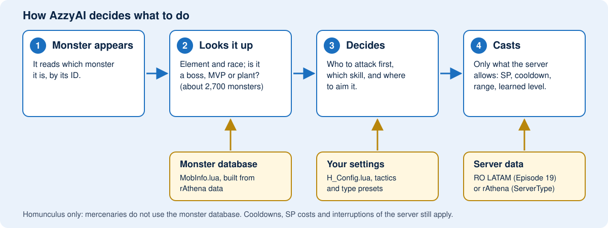

# What this version of AzzyAI adds

[English](ABOUT.md) | [Português (BR)](ABOUT.pt-BR.md) | [Español](ABOUT.es.md)

[Back to README](../README.md) | [User manual](MANUAL.md)

## How it works

The homunculus reads which monster it is looking at and checks it in a list of
about 2,700 monsters. Your settings and tactics then decide who to attack and
which skill to use, and the server data keeps every cast within what your server
accepts. [Open the full-size figure](hg-how-en.svg).

## What you can configure

| Homunculus | Skills it can use | Worth knowing |
|---|---|---|
| **Eira** | Xeno Slasher, Eraser Cutter, Silent Breeze, Twister Cutter, Absolute Zephyr, Overed Boost, Light of Regenerate | Light of Regenerate is optional and off by default: it needs Loyal intimacy and lowers it on every cast. |
| **Bayeri** | Stahl Horn, Heilige Stange, Stein Wand, Goldene Ferse, Angriffs Modus, Glanzen Spies, Heilige Pferd, Goldene Tone | The Bayeri preset picks between Stahl Horn, Spies and the area skills by the target's DEF. |
| **Sera** | Needle of Paralyze, Poison Mist, Summon Legion, Pain Killer, Toxin of Mandara, Needle Stinger | Toxin of Mandara and Needle Stinger have casts that can be interrupted. |
| **Dieter** | Magma Flow, Granitic Armor, Lava Slide, Pyroclastic, Volcanic Ash, Blast Forge, Tempering | His attacks are area skills, so his preset attacks even a single monster. Fire skills are skipped against Fire monsters. |
| **Eleanor** | Style Change, Sonic Claw, Silvervein Rush, Midnight Frenzy, Tinder Breaker, CBC, EQC, Blazing And Furious, The One Fighter Rises | Sonic Claw needs fighting style; Tinder Breaker, CBC and EQC need grappling style. The AI switches style for you. |
| **Lif, Amistr, Filir, Vanilmirth** | Their own skills, and the inherited ones in a Homunculus S | It detects the base type of a Homunculus S by itself. |
| **Mercenaries** | Tactics, skills and kiting, as in the original AzzyAI | They do not use the monster database. |

Skills only work if your server offers them and your homunculus has learned
them. The [user manual](MANUAL.md#6-notes-for-each-homunculus-s) has notes for each one.

## Compared with the original AzzyAI

The original AzzyAI (the `classic` branch) is still a good AI. This version keeps what it
does and adds the following. This is what you would notice in game:

| | Original AzzyAI | This version |
|---|---|---|
| **Which monster is it?** | No monster data. You write a tactics row for each monster yourself. | Knows the element, race and boss/MVP/plant flags of every monster (about 2,700), so it works well on monsters you never configured. |
| **Skills vs. element** | Uses a skill even on a monster that resists it. | Skips a skill that would do less than half damage (adjustable) and uses another attack. Dieter does not throw Lava Slide at a Fire monster. |
| **Area skills** | Counts monsters, whatever their element. | Counts only the monsters that would really be hurt, and aims at them even when the one in front is immune. |
| **Plants and mushrooms** | Guesses plants by how they behave (`AutoDetectPlant`). | Knows exactly which ones are plants (they take 1 damage from everything) and saves SP for the others. |
| **MVPs** | Only what you put in the tactics. | By default it does not *start* a fight with an MVP, but still defends you. Optional: always attack MVPs. |
| **A cast that keeps being interrupted** | A fixed retry limit (`SkillRetryLimit`), nothing smarter. | Pauses that skill for a few seconds after a few interruptions and uses something else. |
| **Skill levels** | Most Homunculus S skills stop at level 5 in its table. | Current max levels (10 for most) and only casts levels your homunculus has learned. |
| **Homunculus S skills** | Eira, Bayeri, Sera, Dieter and Eleanor basics. | Also Twister Cutter, Absolute Zephyr, Toxin of Mandara, Needle Stinger, Glanzen Spies, Heilige Pferd, Goldene Tone, Blazing And Furious, The One Fighter Rises, Blast Forge and Tempering. |
| **Eleanor** | Style change and combos. | Also spheres by the server's rules (what each skill costs), combo timing and the two new skills. |
| **Your server's numbers** | One set of values. | Official data (RO LATAM, Episode 19) or rAthena data, chosen with `ServerType`, so cooldowns, ranges and costs match your server. |
| **Settings** | Windows app. | The Windows app and a **browser page** in English, Português and Español, with skill descriptions, presets per homunculus and suggested monster tactics for a map. |
| **Updates** | Manual. | The Windows app can update the AI and the monster data for you, without touching your settings. |
| **Testing** | No offline test suite. | Each change runs against a simulated server (more than 130 scenarios) before it is published. |

The monster-aware features are for **homunculi**. Mercenaries get the tools and
the bug fixes, but not the monster database.

## Should you switch?

**It is a good fit if** you play Eira, Bayeri, Sera, Dieter or Eleanor, you want
to tune behavior without reading code, or you hunt packs and want area skills
used well.

**You may not need it if** your current AI already does what you want, or your
server has different skill rules and you would rather not test.

**Trying it is safe:** back up your `AI` folder first. Going back is just
restoring that backup. Your tactics and friend list can be kept (see the
[update checklist](MANUAL.md#updates-and-backups)).

## What changes by default

These are on from the start; each can be turned off in the configuration tool.

- **Monster database** (`UseMobInfo`): element, plants and bosses are taken into account.
- **MVPs** (`BossAggro`): the homunculus does not start fights with MVPs.
- **Commanded fights** (`CommandedFightStay`): a monster you tell it to attack is fought until it dies.

Optional extras, off by default: smarter target choice (`TargetPriority`),
keeping distance by the monster's real range (`KiteByRange`), kiting before the
first hit (`KiteParanoid`) and escaping when HP drops fast (`UseDamageDanger`).
Offline tests cover them, but they have not been verified in game yet.

## Honest status

This version is tested offline and on a local rAthena server. That is not a guarantee for
every official client or server. New skills only work if your server supports
them and your homunculus has learned them. Enabling a skill does not guarantee
it is used on every attack: range, SP, cooldown and element still matter.
Server cooldowns, SP costs and cast interruptions still apply.
