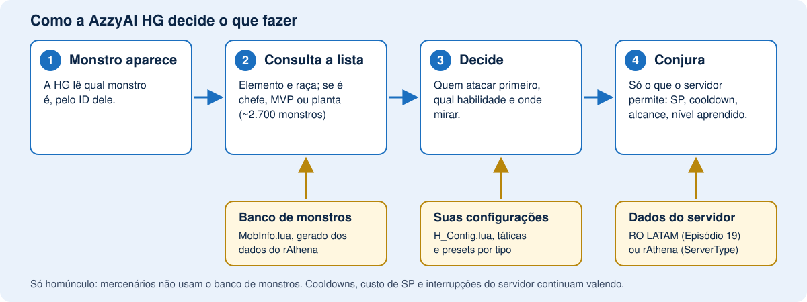

# O que esta versão do AzzyAI acrescenta

[English](ABOUT.md) | [Português (BR)](ABOUT.pt-BR.md) | [Español](ABOUT.es.md)

[Voltar ao README](../README.pt-BR.md) | [Manual do usuário](MANUAL.pt-BR.md)

## Como funciona

O homúnculo lê qual monstro está vendo e o consulta numa lista de cerca de 2.700
monstros. Suas configurações e táticas decidem então quem atacar e qual
habilidade usar, e os dados do servidor mantêm cada conjuração dentro do que o
seu servidor aceita. [Abrir a figura em tamanho grande](hg-how-pt-BR.svg).

## O que você pode configurar

| Homúnculo | Habilidades que ele pode usar | Bom saber |
|---|---|---|
| **Eira** | Xeno Slasher, Eraser Cutter, Silent Breeze, Twister Cutter, Absolute Zephyr, Overed Boost, Light of Regenerate | Light of Regenerate é opcional e vem desligada: exige intimidade Leal e reduz a intimidade a cada conjuração. |
| **Bayeri** | Stahl Horn, Heilige Stange, Stein Wand, Goldene Ferse, Angriffs Modus, Glanzen Spies, Heilige Pferd, Goldene Tone | O preset do Bayeri escolhe entre Stahl Horn, Spies e as habilidades em área pela DEF do alvo. |
| **Sera** | Needle of Paralyze, Poison Mist, Summon Legion, Pain Killer, Toxin of Mandara, Needle Stinger | Toxin of Mandara e Needle Stinger têm conjurações que podem ser interrompidas. |
| **Dieter** | Magma Flow, Granitic Armor, Lava Slide, Pyroclastic, Volcanic Ash, Blast Forge, Tempering | Os ataques dele são em área, então o preset dele ataca até um único monstro. Habilidades de fogo são puladas contra monstros de Fogo. |
| **Eleanor** | Style Change, Sonic Claw, Silvervein Rush, Midnight Frenzy, Tinder Breaker, CBC, EQC, Blazing And Furious, The One Fighter Rises | Sonic Claw exige o estilo luta; Tinder Breaker, CBC e EQC exigem o estilo agarrar. A IA troca de estilo por você. |
| **Lif, Amistr, Filir, Vanilmirth** | As habilidades deles, e as herdadas num Homúnculo S | Ele detecta sozinho o tipo base de um Homúnculo S. |
| **Mercenários** | Táticas, habilidades e kiting, como no AzzyAI original | Não usam o banco de monstros. |

As habilidades só funcionam se o seu servidor as oferecer e o homúnculo as tiver
aprendido. O [manual do usuário](MANUAL.pt-BR.md#6-dicas-por-homúnculo-s) tem notas sobre cada um.

## Comparação com o AzzyAI original

O AzzyAI original (a branch `master`) continua sendo uma boa IA. Esta versão mantém o
que ele faz e acrescenta o que está abaixo. É o que você notaria no jogo:

| | AzzyAI original | Esta versão |
|---|---|---|
| **Que monstro é este?** | Sem dados de monstros. Você escreve uma linha de tática para cada um. | Conhece elemento, raça e se é chefe/MVP/planta de cada monstro (cerca de 2.700), então funciona bem em monstros que você nunca configurou. |
| **Habilidades x elemento** | Usa a habilidade mesmo num monstro que resiste a ela. | Pula a habilidade que daria menos da metade do dano (ajustável) e usa outro ataque. O Dieter não joga Lava Slide num monstro de Fogo. |
| **Habilidades em área** | Conta monstros, seja qual for o elemento. | Conta só os monstros que realmente sofreriam dano e mira neles, mesmo quando o da frente é imune. |
| **Plantas e cogumelos** | Adivinha as plantas pelo comportamento (`AutoDetectPlant`). | Sabe exatamente quais são plantas (recebem 1 de dano de tudo) e guarda o SP para os outros. |
| **MVPs** | Só o que você colocar nas táticas. | Por padrão não *começa* luta com MVP, mas ainda defende você. Opcional: atacar sempre os MVPs. |
| **Conjuração que vive sendo interrompida** | Limite fixo de tentativas (`SkillRetryLimit`), nada mais esperto. | Pausa a habilidade por alguns segundos depois de algumas interrupções e usa outra coisa. |
| **Níveis das habilidades** | A maioria das habilidades de Homúnculo S para no nível 5 na tabela dele. | Níveis máximos atuais (10 na maioria) e só conjura níveis que o homúnculo já aprendeu. |
| **Habilidades de Homúnculo S** | O básico de Eira, Bayeri, Sera, Dieter e Eleanor. | Também Twister Cutter, Absolute Zephyr, Toxin of Mandara, Needle Stinger, Glanzen Spies, Heilige Pferd, Goldene Tone, Blazing And Furious, The One Fighter Rises, Blast Forge e Tempering. |
| **Eleanor** | Troca de estilo e combos. | Também esferas pelas regras do servidor (quanto cada habilidade custa), tempo dos combos e as duas habilidades novas. |
| **Os números do seu servidor** | Um único conjunto de valores. | Dados oficiais (RO LATAM, Episódio 19) ou do rAthena, escolhidos com `ServerType`, para que cooldowns, alcances e custos batam com o seu servidor. |
| **Configuração** | Aplicativo Windows. | O aplicativo Windows e uma **página no navegador** em English, Português e Español, com descrições das habilidades, presets por homúnculo e sugestão de táticas de monstros por mapa. |
| **Atualizações** | Manuais. | O aplicativo Windows atualiza a IA e os dados de monstros para você, sem mexer nas suas configurações. |
| **Testes** | Sem suíte de testes offline. | Cada mudança roda contra um servidor simulado (dezenas de cenários) antes de ser publicada. |

As funções que reconhecem monstros são para **homúnculos**. Mercenários recebem
as ferramentas e as correções de bugs, mas não o banco de monstros.

## Vale a pena trocar?

**Combina com você se** joga com Eira, Bayeri, Sera, Dieter ou Eleanor, quer
ajustar o comportamento sem ler código, ou caça grupos de monstros e quer
habilidades em área bem usadas.

**Talvez não precise se** a sua IA atual já faz o que você quer, ou se o seu
servidor tem regras de habilidades diferentes e você prefere não testar.

**Experimentar é seguro:** faça backup da pasta `AI` antes. Voltar é só
restaurar o backup. Suas táticas e lista de amigos podem ser mantidas (veja o
[checklist de atualização](MANUAL.pt-BR.md#atualizações-e-backups)).

## O que muda por padrão

Isto vem ligado desde o início; cada item pode ser desligado na ferramenta de
configuração.

- **Banco de monstros** (`UseMobInfo`): elemento, plantas e chefes são levados em conta.
- **MVPs** (`BossAggro`): o homúnculo não começa lutas com MVPs.
- **Lutas ordenadas** (`CommandedFightStay`): um monstro que você mandou atacar é combatido até morrer.

Extras opcionais, desligados por padrão: escolha de alvo mais esperta
(`TargetPriority`), manter distância pelo alcance real do monstro
(`KiteByRange`) e fugir quando o HP cai rápido (`UseDamageDanger`). Os testes
offline cobrem esses extras, mas eles ainda não foram verificados no jogo.

## Situação real

Esta versão é testada offline e num servidor rAthena local. Isso não garante o
funcionamento em todo cliente ou servidor oficial. Habilidades novas só
funcionam se o servidor as oferecer e o homúnculo as tiver aprendido. Ativar
uma habilidade não significa usá-la em todo ataque: alcance, SP, cooldown e
elemento também influenciam. Cooldowns do servidor, custos de SP e
interrupções de conjuração continuam valendo.
